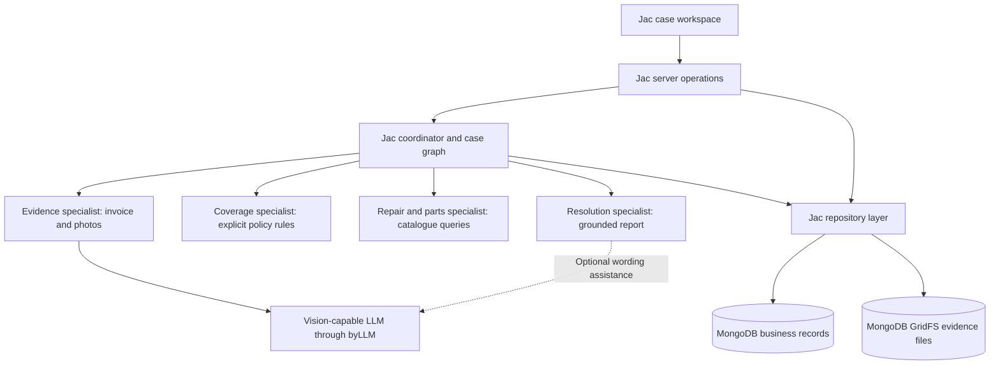

> Historical design document. The current WhatsApp customer channel and private owner dashboard supersede earlier customer-web and browser-local behavior. See [WHATSAPP.md](WHATSAPP.md).

# Fixora AI — Architecture and Delivery Strategy

Status: backend implementation plan with a runnable browser-local UI prototype; see DEVELOPMENT.md.
Prepared: 17 October 2026.  
Team: three members. Time budget: six hours from implementation kickoff.  
Development baseline: `jac 0.34.13 (Linux x86_64)`, verified locally for the UI prototype.
Persistent database: MongoDB. Hosting target: JacHammer.

**UI scope update:** the latest user direction requires a customer chat and a separate shop dashboard, with the existing assessment features contained in those two primary views. Owner inspection/corrections, approval/rejection, and rule-based automatic decisions are now in scope. [UI_SPECIFICATION.md](UI_SPECIFICATION.md) supersedes older single-workspace and review-exclusion statements below. The interactive UI prototype is implemented; live backend integration remains pending. The original delivery schedule needs reassessment for the expanded scope.

## 1. Product objective

Fixora helps an electronics shop turn an invoice, product photos, and a customer complaint into an evidence-backed warranty review and repair proposal. Customers submit evidence and answer follow-up questions through chat. The shop inspects findings and records decisions through its dashboard; explicit shop rules may resolve sufficiently evidenced cases automatically.

The demonstration must show more than successful extraction: conflicting or missing evidence must change the workflow. The application must retain cases and uploaded evidence after a server restart.

Default demonstration scope is one shop, laptops, three explicitly supported product models, and English. These are planning defaults, not established business requirements. Select the actual models and sample policy in the first 30 minutes.

### Success criteria

- Upload an invoice image, up to three product images, and a short complaint.
- Extract purchase information and visible observations with evidence references.
- Evaluate an explicit sample shop policy without inventing coverage terms.
- Route missing or contradictory evidence to clarification or inspection.
- Match a confirmed or provisional repair option to explicitly compatible stock.
- Show customer-facing findings in chat and the full recommendation, supporting evidence, and owner actions inside the shop dashboard.
- Persist the case, conversation, files, assessment, and automatic/owner decisions in MongoDB.
- Demonstrate the same workflow locally and on JacHammer, subject to an early hosting compatibility check.

## 2. Scope boundaries

| Area | Required MVP | Stretch, only after the core passes | Out of scope |
| --- | --- | --- | --- |
| Intake | JPEG/PNG invoice, product photos, description; upload validation | Single-page PDF invoice | Multipage document pipelines, email ingestion, arbitrary URL fetching |
| Documents | Invoice number, purchase date, model, serial if readable, seller, amount/currency if present | Additional invoice formats | Invoice authenticity certification, fraud detection claims |
| Vision | Visible observations, image limitations, possible affected areas | Region highlights if reliably available | Hidden-component diagnosis, trained defect detector, damage-cause certainty |
| Warranty | Date eligibility plus versioned shop-policy conditions; manual review when uncertain | Additional sample policies | Legally binding coverage decisions, manufacturer claims submission |
| Repairs | Curated repair catalogue; technician-confirmed diagnosis controls firm recommendations | Additional models and repair options | Unrestricted generated repair procedures, automatic replacement/refund authorization |
| Inventory | Exact model-to-part compatibility, availability snapshot, seeded prices | Simple stock editor | Supplier APIs, purchasing, stock reservation/decrement, warehouse management |
| Turnaround | Omit if needed for time | Rule-based range from labour, queue, and known part lead time | Training or claiming a predictive ML model |
| Workflow | Jac coordinator, bounded specialist stages, conditional routing, evidence trail | Richer visual graph | Open-ended agent loops, separate agent microservices, message broker |
| Interface | Customer chat and shop dashboard; embedded case details, evidence, findings and review controls | Print-friendly report | Additional primary screens, native mobile app, notifications |
| Access | Customer-scoped case/file access and owner-only review; verified demo access during development | Full account-management experience | Production multi-tenancy, full roles/billing/SSO |
| Persistence | MongoDB records and GridFS uploads | Export/import tools | A second business database, vector database, analytics platform |

News checking, scam checking, IP matching, and model unlearning from the earlier brainstorming are outside Fixora's scope.

## 3. Architectural decisions

| Decision | Choice | Reason |
| --- | --- | --- |
| Application structure | One Jac full-stack application | One build and deployment boundary for a small team |
| Jac usage | UI, server operations, contracts, coordinator, rules, specialist wrappers, repositories written primarily in Jac | Makes Jac central to the product; target 80%+ authored application code where practical |
| AI integration | byLLM with one available vision-capable provider/model | Reuse one integration for invoice and photo understanding |
| Business persistence | Explicit MongoDB repositories using PyMongo through Jac server imports | Predictable collections and one authoritative data store |
| Evidence files | MongoDB GridFS; file IDs referenced by case records | Files survive deployment restarts without a separate storage service |
| Graph use | Temporary case graph assembled from MongoDB records for coordinator traversal | Demonstrates nodes/walkers without maintaining two persistent copies |
| Workflow execution | Bounded stages advanced through server operations | Avoid long all-in-one requests and background-worker infrastructure |
| Business rules | Deterministic dates, policy checks, arithmetic, compatibility and stock queries | The model cannot invent eligibility, quantities, or prices |
| Hosting | JacHammer application connected to an external reachable MongoDB database | Localhost MongoDB is not reachable from a hosted application |

Jac documents Python package imports on the server and React-style client components: [Python interoperability](https://www.jac-lang.org/reference/import-anything/) and [full-stack guide](https://www.jac-lang.org/build/fullstack-web/). byLLM documents structured outputs and image inputs: [byLLM reference](https://www.jac-lang.org/reference/plugins/byllm/).

**Version boundary:** these are rolling documentation pages, not a verified reference for release 0.34.13. The user's Linux runtime has not been executed or validated while writing this plan. Confirm imports, client/server calls, uploads, and model configuration against the installed runtime before splitting implementation work. Record exact working dependency versions and share the same configuration across all three members. Do not upgrade the team runtime independently.

### Persistence boundary

MongoDB repositories own business writes. Do not also attach the same case graph to Jac's persistent root or rely on its default local store for case durability. Build a transient graph from repository data, run the relevant walker, serialize the structured result, and save it through the repository.

Jac also documents native Mongo-backed graph persistence, but that is an alternative design rather than a second layer to add to this MVP. If the team chooses it instead, change this decision and data ownership together before coding. [Jac persistence reference](https://www.jac-lang.org/reference/persistence/)

## 4. System layout



Logical graph nodes: `Case`, `Evidence`, `Observation`, `PolicyClause`, `RepairOption`, and `Part`. Useful relationships: `has_evidence`, `supports`, `conflicts_with`, `evaluated_against`, and `requires_part`. Use stable document IDs to associate graph nodes with MongoDB records.

The coordinator controls the next stage. Specialist functions cannot approve a case or write inventory. The UI must show actual persisted stage status rather than simulated progress.

## 5. Specialist responsibilities

| Specialist | Inputs | Outputs | Method and limits |
| --- | --- | --- | --- |
| Evidence | Invoice, photos, complaint | Extracted fields, visible observations, missing fields, conflicts | Two bounded model tasks: invoice extraction and photo observations. Missing/unreadable values remain null. |
| Coverage | Verified/extracted fields, observations, policy version, evaluation date | Date eligibility, coverage assessment, clause IDs, blockers | Rules distinguish warranty period from coverage; uncertain damage cause requires inspection. |
| Repair & Parts | Supported model, observations, optional confirmed diagnosis, catalogue, inventory | Provisional/confirmed options, compatible SKU matches, stock and cost snapshots | Model interpretation may suggest a catalogue category; exact catalogue IDs and compatibility are validated in code. |
| Resolution | Validated findings from earlier stages | Next action, concise explanation, evidence references, report | Prefer a deterministic report template. Optional model wording cannot change facts or decisions. |

These are bounded specialist roles inside one application, not six independently deployed services. The model handles interpretation; the coordinator and rules handle authority and routing.

Every finding carries an evidence or policy reference. For a photo, use the uploaded file ID and a concise observable description; do not manufacture pixel coordinates. For invoice text, retain the extracted source text and its file ID. Show uncertainty as readable limitations, not an uncalibrated confidence percentage.

## 6. Case workflow and decision rules

1. Create a case and persist validated uploads before analysis.
2. Extract invoice fields and product-photo observations.
3. Compare invoice identity with a readable product label or explicit customer/technician input. Do not infer an exact laptop model from appearance alone.
4. Stop for clarification when required evidence is missing or identities conflict.
5. Evaluate warranty dates and applicable shop-policy clauses separately.
6. If fault or cause is uncertain, recommend inspection. Optional repair hypotheses remain provisional and do not become a firm quote.
7. Once a technician records a supported diagnosis, look up the corresponding repair option and exact compatible parts.
8. Build the resolution report and request technician approval.
9. Record the decision with timestamp, reviewer identity/label, assessment version, and notes.

### Case states

| State | Meaning | Allowed next action |
| --- | --- | --- |
| `draft` | Case is being assembled | Add evidence, start assessment |
| `processing` | A bounded stage is running or ready to advance | Read progress, advance the next stage |
| `needs_information` | Required field/evidence is missing or contradictory | Correct/add evidence and reassess |
| `needs_inspection` | Evidence cannot establish a supported diagnosis or coverage condition | Record technician findings and reassess |
| `awaiting_approval` | A complete proposal is ready | Approve proposal or request inspection |
| `approved` | Technician approved the recorded proposal | View; reopen explicitly for a revised assessment |
| `rejected` | The current request/proposal was rejected under an explicit rule or owner decision | View the reason and decision scope; submit clarification or explicitly reopen if permitted |
| `failed` | A technical stage failed or expired | Retry safely; retain earlier evidence |

Coverage is a separate field, not a case state: `potentially_covered`, `outside_period`, `excluded_by_policy`, or `needs_review`. A passed date check alone does not yield covered status. Missing policies yield `needs_review`; unavailable model output never becomes a warranty rejection. Approval/rejection also records its scope (for example, warranty request versus repair proposal), automatic versus owner origin, and the supporting rule/reason. A warranty rejection does not automatically reject paid repair service. Exact automatic-decision predicates remain to be configured; unresolved cases go to owner review.

### Policy and estimate rules

- Represent the demo policy as structured clauses with stable IDs, version, warranty duration, coverage conditions, and exclusions.
- Calculate calendar-month expiry using the policy's defined boundary rule; specify whether the final date is inclusive and how month-end dates are handled.
- Store purchase dates as date-only values; record evaluation date in the shop timezone, initially `Asia/Colombo`. Store event timestamps in UTC.
- Reject future/invalid purchase dates for clarification. Preserve the source value when a technician corrects it.
- Only apply an exclusion when its required evidence is established. A visible scratch does not establish the cause of an unrelated power failure.
- Store money in integer minor units with a currency code. Keep shop repair cost distinct from customer payable amount while warranty coverage is unresolved.
- If turnaround is implemented, calculate a labelled range from configured queue delay, labour range, and known part lead time. Unknown part arrival means no firm completion date. No historical-ML claim.

### Execution and retry strategy

Use short stage operations: `document`, `vision`, `coverage`, `repair_parts`, and `resolution`. The client calls `advance_case` until the case reaches a stopping state; each call completes at most one bounded stage. Closing the browser pauses advancement, and reopening allows explicit resume. Do not promise autonomous background completion.

Begin with a configurable model timeout below the tested hosting request limit and at most one retry for transient provider errors. Validate structured output; an invalid result becomes a stage error, not guessed fields. Confirm these limits in a preview deployment.

Only one active assessment per case is allowed. Use MongoDB conditional updates with case revision, assessment ID, and a stage lease to claim work and reject stale writes. Expired leases allow controlled retry after a crash. Repeated submissions return the existing result for the same request ID. Adding evidence or a technician correction creates a new assessment version and invalidates old approval. No stock or external side effects occur during analysis.

## 7. MongoDB data model

Use one database per environment, for example `fixora_dev` and `fixora_demo`. An external MongoDB service reachable by all three developers and the hosted app reduces connection differences; do not assume JacHammer provisions this database.

| Collection | Main fields | Notes |
| --- | --- | --- |
| `cases` | `_id`, `shop_id`, `description`, `claimed_model_id`, `evidence_ids`, `status`, `revision`, `active_assessment_id`, `stage_lease`, `created_at`, `updated_at`, `review_decisions` | Case state and review history; bounded for the demo |
| `assessments` | `_id`, `case_id`, `version`, `input_revision`, `policy_id`, `policy_version`, `stages`, `extracted_invoice`, `observations`, `conflicts`, `coverage`, `repair_options`, `resolution`, `model_metadata` | One assessment per revision; completed results retain their policy/price snapshots |
| `evidence` | `_id`, `case_id`, `kind`, `gridfs_id`, `mime_type`, `original_name`, `sha256`, `size_bytes`, `uploaded_at` | Metadata only; evidence IDs must belong to the requested case |
| `policies` | `_id`, `shop_id`, `version`, `effective_from`, `duration_months`, `clauses`, `expiry_rule` | Seed one explicit fictional shop policy; preserve versions |
| `products` | `_id`, `manufacturer`, `model_code`, `display_name`, `supported_repair_ids` | Three supported models; no fuzzy substitution |
| `repair_catalog` | `_id`, `diagnosis_code`, `compatible_model_ids`, `required_part_types`, `labour_cost_minor`, `labour_hours_range` | Curated options; validated technician diagnosis values |
| `inventory` | `_id`, `sku`, `part_type`, `compatible_model_ids`, `quantity_available`, `unit_price_minor`, `currency`, `lead_time_days`, `updated_at` | Read-only snapshots in MVP; no reservation guarantee |
| GridFS bucket `uploads` | Driver-managed `uploads.files` and `uploads.chunks` | Durable binary uploads, retrieved through the server |

Create indexes for cases by shop/update time, assessments by case/version (unique), evidence by case, policies by shop/version (unique), and inventory SKU (unique). Use stable IDs and upserts for seed data so reseeding does not duplicate catalogues or overwrite cases.

Start with a 5 MB per-file limit, one invoice and at most three product photos. Confirm transport limits on JacHammer and lower the cap if needed. Validate decoded file types and reasonable image dimensions, not just extensions. Upload files separately rather than sending every image in one large request. Do not place base64 files inside case documents or source control.

GridFS stores file content and metadata through PyMongo and is independent of ephemeral application disk. [MongoDB GridFS documentation](https://www.mongodb.com/docs/languages/python/pymongo-driver/current/crud/gridfs/)

Repository methods expose plain structured values, not database handles. Convert database IDs and timestamps to stable strings at the browser boundary. Reuse a server-side database client with bounded connection timeouts. Persist evidence metadata only after file storage succeeds; a failed metadata write should remove the newly uploaded orphan where possible. Do not claim a cross-collection transaction where none is implemented.

## 8. Shared interfaces: agree before parallel work

These are application contracts, not claims about generated Jac HTTP paths. Member A maps them onto the verified Jac server/client mechanism.

| Operation | Inputs | Result |
| --- | --- | --- |
| `create_case` | Description, optional claimed model, submission ID | Case ID and revision |
| `upload_evidence` | Case ID, revision, file, evidence kind, request ID | Evidence ID and new revision |
| `start_assessment` | Case ID, expected revision, request ID | Assessment ID and current stage |
| `advance_case` | Case ID, assessment ID, expected revision | Updated case/stage summary; one bounded stage maximum |
| `get_case` | Case ID | Case view with evidence metadata and current assessment |
| `list_cases` | Cursor/limit and permitted filters | Customer's own saved conversations or owner complaint queue, scoped by server-verified identity |
| `send_case_message` | Case ID, message, permitted attachment references, request ID | Persisted message and updated conversation summary; internal visibility is owner-only |
| `get_case_messages` | Case ID, cursor/limit | Access-scoped conversation history; customer results exclude internal shop notes |
| `get_evidence` | Case ID, evidence ID | Validated file response |
| `record_inspection` | Case ID, expected revision, supported diagnosis, corrections, notes | New case revision requiring reassessment |
| `review_case` | Case ID, assessment ID, expected revision, approve/reject/request-information/request-inspection action, reason/notes | Persisted owner decision with customer-facing response, or stale-state error |

Specialist result envelope: `stage`, `status`, `findings`, `evidence_refs`, `missing_fields`, `conflicts`, `next_action`, and optional `error`. Status is `completed`, `blocked`, or `failed`. Stage timestamps and assessment IDs are added by the coordinator.

Return consistent errors: `VALIDATION_ERROR`, `UNSUPPORTED_MODEL`, `MISSING_EVIDENCE`, `STALE_REVISION`, `STAGE_BUSY`, `MODEL_TIMEOUT`, and `DATABASE_UNAVAILABLE`. The UI must preserve inputs and offer an appropriate retry or correction action.

Prepare three shared result fixtures immediately: complete case, conflicting evidence, and inspection required. These let the UI and specialists progress before full integration. Fixture mode must be visibly labelled and must not silently replace a failed live model call.

## 9. Team ownership

Assign names to Member A/B/C at kickoff. Ownership is intended to avoid simultaneous edits to shared modules, not prevent collaboration.

| Member | Primary focus | Owns | First deliverable | Completion criteria |
| --- | --- | --- | --- | --- |
| A — Platform and workflow | Jac coordinator, contracts, MongoDB repositories, server operations, deployment | `main.jac`, `jac.toml`, `shared/`, `workflow/`, `data/`, `server/` | Saved case and upload can be retrieved after restart; operation signatures published | Real stage transitions, revision protection, durable evidence, working hosted connection |
| B — Evidence and business logic | Model extraction, visible observations, coverage rules, repair selection, seeds | `specialists/`, `rules/`, `fixtures/`, rule/extraction tests | Validated invoice and photo results using shared fixtures/contracts | Evidence references, null handling, contradiction checks, correct dates, exact compatibility and prices |
| C — Product interface and demo | Customer chat, shop dashboard, uploads, stage activity, embedded case details/review, demo story | `ui/`, `assets/`, interface integration checks, demo notes | Both views render all three shared fixtures | Real backend connected, refresh restores conversations/cases, corrections/review work, uncertainties are visible |

Member A owns deployment because hosting depends on data access and server configuration; Member C owns hosted UI smoke checks and demo rehearsal. Member B supplies realistic synthetic evidence and expected outcomes. All three integrate at hour two; integration is not a final-hour task.

### Coordination rules

- A publishes shared types and operation contracts during the first 30 minutes. B and C request changes rather than editing contracts independently.
- B defines policy/catalogue seed contents; A owns their persistence and the idempotent seed entry point.
- A provides temporary fixture-backed operations; C never builds a second backend.
- Share small working changes at each checkpoint. Keep entrypoint and configuration edits with A.
- A and B jointly settle coordinator/rule boundaries; C and A jointly settle upload transport early.
- No member adds an external service, new framework, or runtime upgrade without checking its integration cost with the team.

### Proposed source layout

```text
main.jac                  # A: app composition and entrypoint
jac.toml                  # A: validated project/dependency configuration
shared/                   # A: contracts and enumerations
server/                   # A: callable operations and upload/file boundary
workflow/                 # A: coordinator, transient graph, transitions
data/                     # A: MongoDB/GridFS repositories and seed entry point
specialists/              # B: document, vision, coverage, repair, resolution
rules/                    # B: policy, date, compatibility and estimate rules
fixtures/                 # B: synthetic policies, catalogue, expected outputs
ui/                       # C: customer chat, shop dashboard, embedded case details/findings/review
assets/                   # C: small bundled visual assets
tests/                    # Each member: checks for owned behavior
```

This layout is proposed only; this strategy document does not create those modules.

## 10. Six-hour delivery plan

| Elapsed time | Member A | Member B | Member C | Shared checkpoint |
| --- | --- | --- | --- | --- |
| 0:00–0:30 | Verify installed Jac patterns; Mongo read/write; publish contracts; check hosting access | Choose model/provider; test one image; define supported models/policy | Confirm client starter and upload transport; sketch workspace | Working dependencies and agreed contracts |
| 0:30–2:00 | Repositories, files, coordinator skeleton, fixture-backed operations; early hosting probe | Real extraction, visible observations, coverage and catalogue rules; fixture cases | Workspace, file intake, activity/results, fixture integration | A case can be saved; each member has a usable component |
| 2:00–3:00 | Wire real specialists into stage operations | Fix actual result/contract mismatches | Connect real operations and reload saved cases | One complete live path; otherwise freeze all stretch work |
| 3:00–4:00 | Conditional routing, inspection/review persistence, retries | Conflicts, date boundaries, compatibility and cost checks | Missing-info and inspection controls; evidence links | Contradictory case changes route correctly |
| 4:00–5:00 | JacHammer preview, environment configuration, persistence/restart check | Evaluate scenario outputs; resolve factual/rule errors | Hosted smoke checks and readability polish | Hosted complete path or explicit hosting blocker |
| 5:00–6:00 | Fix release blockers; final deploy if available | Final expected-result checks; optional estimate only if already stable | Rehearse three scenarios and prepare labelled saved results | Freeze features and deliver the demo |

If less than six hours remain, compress scope rather than leaving integration or hosting to the final minutes. Cut in order: turnaround estimate, rich graph visualization, print/PDF extras, then reduce the catalogue to one model. Preserve MongoDB durability, evidence-backed uncertainty, and the complete technician workflow.

## 11. JacHammer deployment strategy

Treat the requested "jackhammer" host as JacHammer. Its documented CLI supports local-project preview deployment and production deployment; environment values apply on subsequent deployment. The documentation also describes an approximate 10 MB zipped upload cap, so keep uploaded evidence, local environments, and generated output out of the deployment bundle. [JacHammer CLI reference](https://docs.jachammer.ai/features/cli)

Member A verifies early:

1. The team account can deploy under its hackathon entitlement/plan and has available quota.
2. Hosted Jac runtime compatibility with the project's 0.34.13 baseline, Python dependencies, and byLLM configuration.
3. Outbound access to the chosen MongoDB service and model provider, including database network access settings.
4. Hosted upload and request-duration limits for the staged workflow.
5. Which environment separation mechanism is available; use separate projects if preview and production cannot safely use different databases.

Application environment contract: `MONGODB_URI`, `MONGODB_DB`, `FIXORA_MODEL`, `FIXORA_DEMO_MODE`, and `FIXORA_SHOP_TIMEZONE`, plus the actual provider-specific API-key variable and the chosen demo-access secret. The `FIXORA_*` names are proposed application settings that the team must implement; they are not built-in Jac variables. Keep credentials server-side and out of committed files and client bundles.

Deployment sequence: validate local build → deploy a preview → verify model and MongoDB access → create/reload a case and its files → confirm data after application restart → publish the final release. Follow installed CLI help for exact commands; the documentation currently describes `jachammer deploy` for preview and `jachammer deploy --prod` for production. No deployment is performed by this document.

Do not assume application-local files survive hosting or that local `localhost` database settings will work remotely. If hosting remains blocked, retain a working local demonstration and clearly report it as local rather than claiming deployment succeeded.

## 12. Access and data handling for the prototype

Use synthetic invoices and product evidence for the hackathon. Keep hosted case operations, file retrieval, and technician actions behind server-enforced access. Customers can read/write only their own cases and files; only the shop can inspect all complaints, read internal notes, or record owner decisions. A simple verified demo access mechanism may be used during development, but a shared customer credential cannot establish separate private customer ownership. A hidden button or role switch is not access control. Full account-management screens remain outside the two-view scope.

Treat invoice text, descriptions, and image text as untrusted input. They cannot override the fixed policy, select arbitrary database queries, or instruct specialists to expose credentials. Validate every model result against contracts and the catalogue. Store concise findings and evidence references rather than hidden model reasoning. Log case/stage IDs and errors without invoice contents, secrets, or raw provider payloads.

## 13. Acceptance checks and demonstration

| Scenario | Required behavior |
| --- | --- |
| Complete evidence, within period, supported diagnosis | Clause-backed assessment, compatible part/cost snapshot, technician approval recorded |
| Invoice/product identity conflict | `needs_information`; no firm repair proposal until clarified |
| Visible damage plus unexplained power fault | Separate observation from cause; request inspection rather than inventing internal failure |
| Missing date, unreadable image, unsupported model | Explicit limitation and correction/inspection route; no guessed identity/date |
| Expiry boundary and month-end purchase | Deterministic result following the recorded sample policy |
| Compatible part out of stock | Honest availability; unknown lead time does not become a completion promise |
| Provider timeout or database failure | Technical failure/retry state; never reinterpret as warranty rejection |
| Refresh, restart, or repeated submit | Saved files/results remain; no duplicate active assessment or duplicate approval |
| Correction after assessment | New revision; old findings retained as history but not presented as current approval |
| Stale approval request | Rejected until the reviewer loads the latest assessment |

Prioritize focused tests of date boundaries, missing fields, compatibility, revision checks, and restart persistence. Add a few live extraction checks against the chosen fixtures; do not claim general damage-detection accuracy from a three-case demo.

Rehearse a three-minute narrative: upload a normal case, show the evidence trail, introduce a contradictory case, then record an inspection that changes the recommendation. Finish by reopening a saved case to demonstrate persistence. Label seeded stock, fictional shop policies, and saved fallback results visibly.

## 14. Definition of done

- [ ] Team uses one validated Jac runtime/dependency baseline.
- [ ] MongoDB is the authoritative persistent business store; evidence is durable.
- [ ] A real upload-to-review workflow completes.
- [ ] At least one conflicting-evidence case takes a different coordinator route.
- [ ] Inventory compatibility, dates, and prices come from rules/data, not invention.
- [ ] Technician decisions reference the current assessment and survive reload.
- [ ] Three scenarios have been checked against expected outcomes.
- [ ] Hosted build has been verified, or the remaining hosting limitation is explicit.
- [ ] Demo accurately distinguishes implemented features, seeded inputs, estimates, and roadmap items.

Deferred roadmap: customer accounts, additional categories, supplier integrations, controlled stock reservation, real repair-history collection, evaluated turnaround models, and manufacturer claim-system integrations.
